  

  <h1>Hi, I'm Tasfia Tabassum</h1>
  
<em>Welcome to my GitHub profile!</em>

  

    
    &nbsp;&nbsp;&nbsp;&nbsp;
    
    &nbsp;&nbsp;&nbsp;&nbsp;
    
  

  

    
    &nbsp;&nbsp;&nbsp;
    
    &nbsp;&nbsp;&nbsp;
    
  

---

  <h2>🚀 Currently working on</h2>
  
Learning, experimenting, and building new things one project at a time.

---

  <h2>✨ Thanks for visiting ✨</h2>
  
Feel free to explore my repositories and follow along as I build and learn.

---

  <h2>🛠️ Tech Stack</h2>
  
  
  
  
  
  
  
  
  
  

  <h2>🔗 Connect with me</h2>
  
  
  
  

---

  <h2>📊 GitHub at a glance</h2>
  
    
  
  &nbsp;
  

